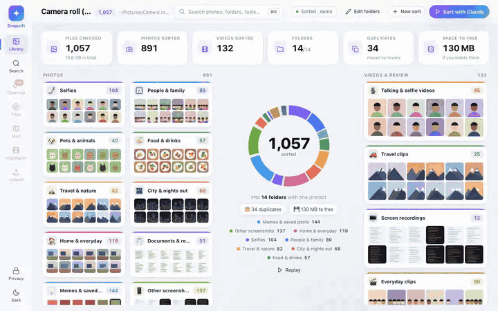

# Snapsift

Point Claude at your camera roll, or at several Google accounts' worth of photos. It looks at every photo and video, sorts them into folders, finds duplicates across all your accounts, finds the junk and the private stuff, groups trips and events, and you watch it happen on a live dashboard on your own laptop.

Based on [claude-photo-sorter](https://github.com/kairothq/claude-photo-sorter) by Divy Kairoth (MIT).



*The demo uses drawn placeholder images, not real photos. It was recorded with the original design; Snapsift adds a tools bar (search, accounts, clean up, trips, map, highlights, upload, privacy) and the review folders.*

- **Sorts** photos and videos into folders like Selfies, Food, Travel, Screenshots, Talking heads and Screen recordings. Use the standard folders or make your own.
- **Several Google accounts at once.** Put one Takeout export per account in one folder. Duplicates are found across all of them, your main account's copy is always kept, and every other account gets a **delete list**, plus a storage report per account.
- **Duplicates done right:** identical copies, "storage saver" copies, bursts (it keeps the sharpest) and re-saved screenshots. Takeout's `-edited` copies are your edits, not duplicates, so they're never flagged.
- **Review folders:** `_Review/Junk` (blurry, dark, pocket shots, expired codes), `_Review/Private` (IDs, cards, passwords), `_Review/Not sure` (Claude looked twice and still wasn't sure).
- **Trips and events** become albums, optionally named by Claude ("Goa beach trip").
- **Fixes dates** that Google Takeout loses, so re-uploaded photos land on the right day.
- **Search** by what's in the photo ("beach sunset", "receipt", "2023").
- **Map**, **yearly highlights videos**, **upload to one Google Photos account** (as albums), **import into Apple Photos**.
- **Never touches your originals** unless you ask it to move duplicates to the Trash, and then only after you confirm the count. Everything else is copies, and on a Mac the copies take no extra space.
- **Runs on your computer.** Your photos are not uploaded anywhere unless you press Upload.

## Start here (no coding needed)

You need a Mac and a Claude plan. Windows and Linux work too, with fewer conveniences.

1. Install Claude Code from [claude.com/claude-code](https://claude.com/claude-code), either in your terminal or as the VS Code extension (Snapsift finds either).
2. Ask Claude: `Set up and open https://github.com/bansalayush247/snapsift`
3. In the dashboard, press **Choose folder** and pick your photos, choose where the sorted copies go, then press **Start sorting**.

About 4 minutes for 1,000 photos.

### Several Google accounts

1. For each account: go to [takeout.google.com](https://takeout.google.com) signed in to it, select only **Google Photos**, export, download and unzip.
2. Put each export in its own folder inside one parent folder:
   ```
   All Google Photos/
     personal/   (Takeout export of account 1)
     work/       (Takeout export of account 2)
   ```
3. Choose **All Google Photos** in the dashboard. Snapsift notices the accounts and ticks **Each subfolder is a different account**.
4. After sorting, open **Accounts**, pick your main account, and use the delete lists. Google doesn't let any app delete photos, so you delete them in photos.google.com, where Trash keeps them for 60 days.

## The dashboard

| | |
|---|---|
| **Advanced** (before sorting) | Folders, Claude model (Haiku, Sonnet or Opus), year/month subfolders, date fixing, trip albums, second look, try 200 files first |
| **Search** (press `/`) | Words, folder names, account names, dates like `2023` or `march` |
| **Accounts** | Storage per account, pick the main account, delete lists |
| **Clean up** | Duplicates (and Move to Trash), Junk, Private, Not sure, biggest videos |
| **Trips & events** | Albums of trips and events. "Name them with Claude" |
| **Map** | Photos on a map. Street map is off until you turn it on |
| **Highlights** | Best photos of each year plus a slideshow video |
| **Upload** | Google Photos (one album per folder) or Apple Photos |
| **Privacy** | What stays and what leaves. "Forget this library" |
| Click a folder | Browse it. Click a photo to see it full size, then use **Move** if it's in the wrong place. Snapsift remembers and Claude learns from it |

Sorting the same folder again only looks at new photos.

## Privacy

- The dashboard only listens on `127.0.0.1` and only answers pages it served itself (so other websites can't reach it, including through DNS rebinding).
- Previews, captions, labels and lists stay in `dashboard/data/` and `work/`, your folder setup in `config/`, and Google sign-in in `secrets/` (owner-only permissions). None of these are ever committed.
- **What Claude sees:** small previews, and for each file its date, camera, file name and "near/far from home". No coordinates, no folder paths. Claude runs with only the Read tool, only inside a private temporary folder holding the preview sheets (outside this repo), with no MCP servers, no hooks and no saved session, and it's told that text inside photos is not instructions. Text in a photo could still sway how *that* photo is labelled, so glance at a photo before you upload it if it matters.
- **Naming trips with Claude:** dates, captions and a location rounded to about 10 km.
- **Map:** street tiles come from OpenStreetMap only if you turn them on.
- **Google Photos upload:** the files you choose, location removed by default (EXIF and XMP). Signing out also revokes the access at Google. Snapsift can only *add* photos (`photoslibrary.appendonly`). It can't see or delete anything already there.
- **Jev** (optional, paid): a 280px preview per file to TypeSafe.

## How it works

1. **Scan** (`scan.py`): makes a preview, fingerprint, date, place, camera, sharpness and brightness for each file. Only new files on later runs.
2. **Duplicates** (`dupes.py`): identical bytes, and look-alikes by perceptual hash (bucketed, so big libraries stay fast).
3. **Labels** (`label_claude.py`): runs `claude -p` four at a time, about 90 previews per call, then takes a closer look at the unsure ones.
4. **Trips & events** (`events.py`), **Folders** (`apply.py`), **Report** (`report.py`).
5. Extras: `highlights.py`, `upload_google.py`, `export_apple.py`, `trash_dupes.py`.

## Running it by hand

```
./setup.sh          # once: Python packages into .venv/
./start.sh          # opens http://127.0.0.1:8765
./start.sh --demo   # a look without your own photos
.venv/bin/python -m unittest discover -s tests   # tests: drawn fake library, fake Claude, fake Google
```

Needs Python 3.9+, and ffmpeg for video previews and highlights (`brew install ffmpeg`). Agents read `CLAUDE.md` (or `AGENTS.md`) for the full playbook.

## License

MIT. See [LICENSE](LICENSE).
